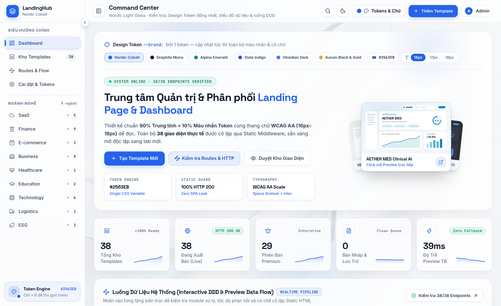
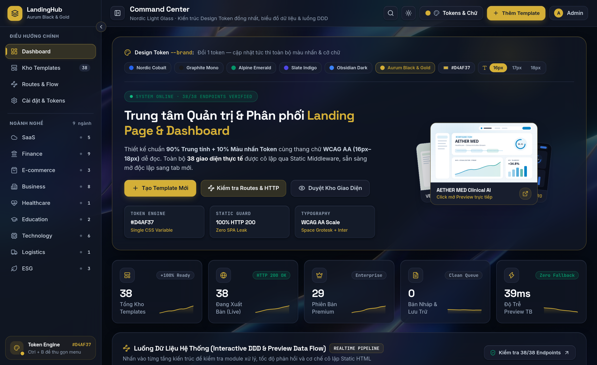
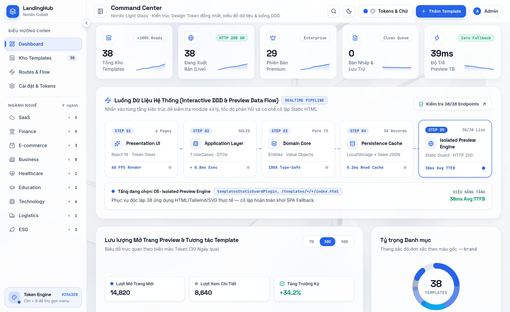
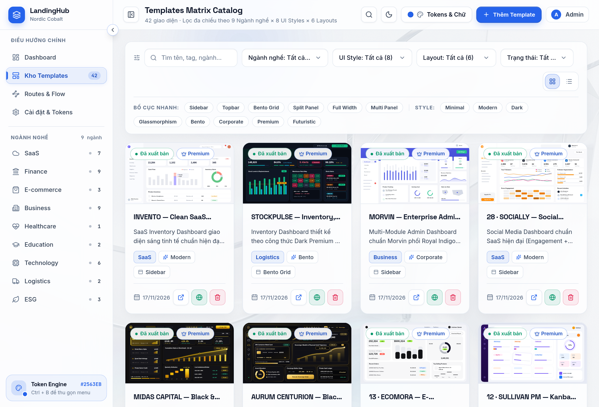
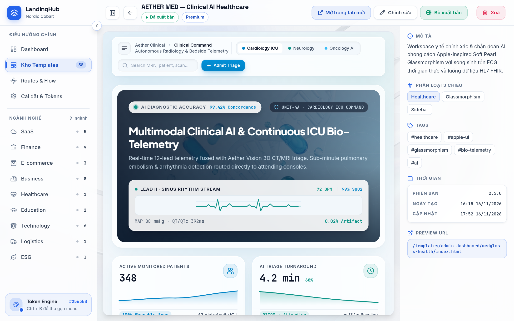
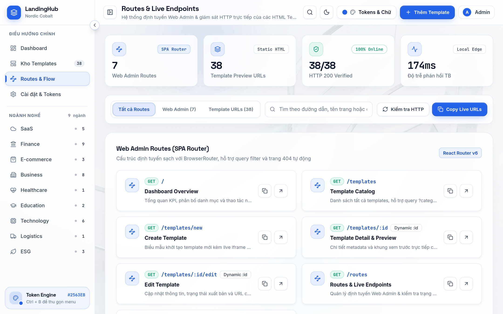
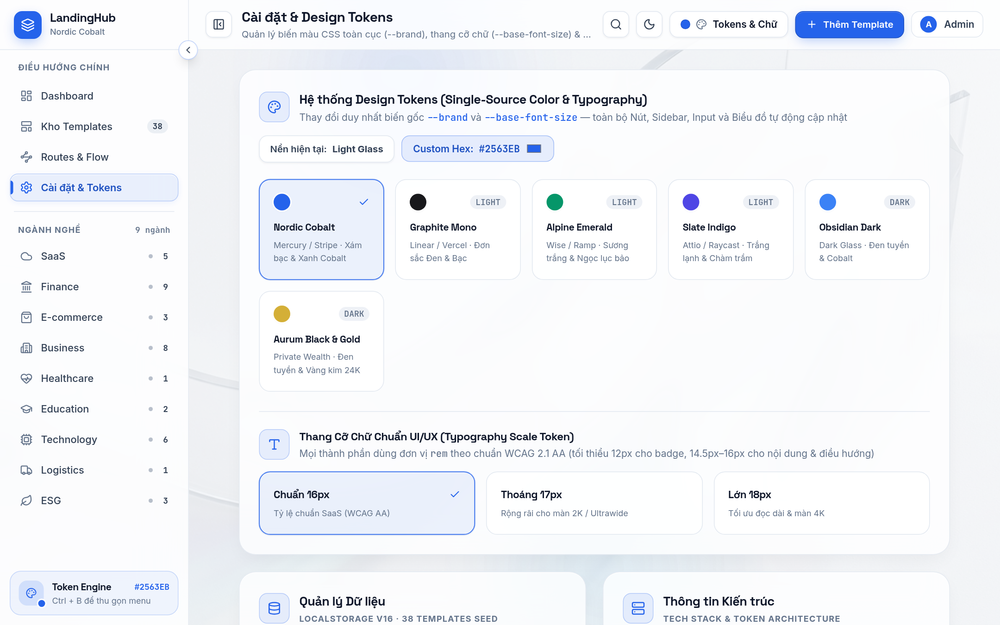
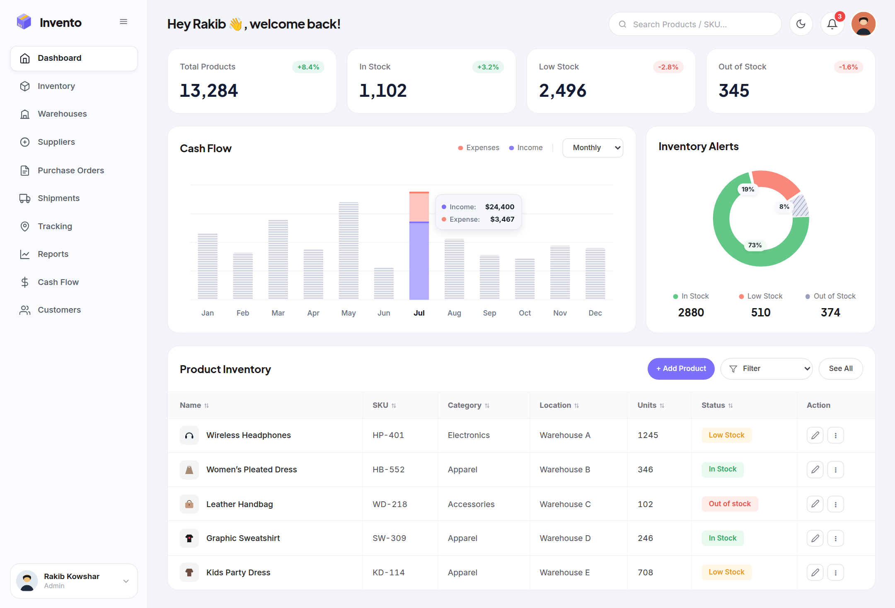
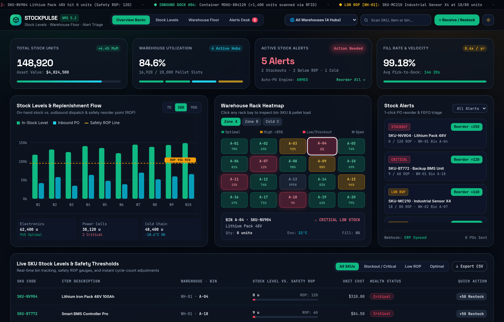

<div align="center">

# 🚀 LandingHub — Command Center

**Trung tâm Quản trị, Lưu trữ & Phân phối Landing Page & Admin Dashboard Đa Ngành**  
*Thiết kế theo chuẩn Domain-Driven Design (DDD) · Single-Source Design Token Engine · Static Guard Middleware*

[](https://react.dev/)
[](https://www.typescriptlang.org/)
[](https://vite.dev/)
[](https://tailwindcss.com/)
[](#danh-mục-42-templates-thực-tế)

</div>

---



## 📖 Giới thiệu

**LandingHub** là hệ thống Web Admin (Command Center) dùng để quản lý, phân loại đa chiều, xem trước trực tiếp (Live Preview) và giám sát trạng thái HTTP của kho **42 giao diện Landing Page & Admin Dashboard thực tế**.

Hệ thống tuân thủ nguyên lý thiết kế **90% Trung tính + 10% Màu nhấn Token**, thang cỡ chữ chuẩn **WCAG 2.1 AA (`16px`–`18px`)** và kiến trúc **Clean Architecture / Domain-Driven Design (DDD)** giúp tách biệt hoàn toàn nghiệp vụ lõi khỏi tầng hiển thị và lưu trữ.

---

## ✨ Tính năng nổi bật

- 🎨 **Single-Source Design Token Engine (`--brand` & `--base-font-size`)**
  - Chỉ cần đổi **1 biến CSS gốc**, toàn bộ màu nhấn, nút bấm, viền kính mờ (Glassmorphism), Sidebar và biểu đồ dữ liệu tự động đồng bộ tức thì.
  - Tích hợp sẵn **6 Theme Presets** (*Nordic Cobalt*, *Graphite Mono*, *Alpine Emerald*, *Slate Indigo*, *Obsidian Dark*, *Aurum Black & Gold*), bộ chọn màu **Custom Hex** tùy ý, chuyển đổi **Light / Dark Glass** và 3 mức thang chữ (`16px`, `17px`, `18px`).
- 🗂️ **Kho 38 Giao diện Thực tế — Ma trận Lọc 3 Chiều**
  - Phân loại chi tiết theo **9 Ngành nghề** × **8 Phong cách UI (UI Styles)** × **6 Bố cục (Layouts)**.
  - Đầy đủ chức năng tìm kiếm tức thì, lọc nhanh bằng tag/chip, thêm mới, chỉnh sửa, xuất bản/lưu trữ và xem trước trực tiếp qua iframe.
- 🛡️ **Static Guard Middleware (Zero SPA Fallback Leak)**
  - Plugin Vite tùy chỉnh (`templatesStaticGuardPlugin`) phục vụ độc lập toàn bộ tài nguyên tĩnh tại `/templates/**` và tự động đóng gói vào `dist/templates` khi build.
  - Chặn đứng lỗi SPA Fallback của Vite (không bao giờ trả nhầm `index.html` của trang Admin khi file template bị thiếu, thay vào đó trả đúng mã `HTTP 404` cô lập).
- 🩺 **Giám sát Routes & Kiểm tra HTTP Realtime (`/routes`)**
  - Tự động quét và xác thực `HTTP 200 OK` cùng độ trễ phản hồi (`ms`) của toàn bộ **38/38 đường dẫn Template** và **7 SPA Routes** của trình quản trị.
- 🏛️ **Kiến trúc DDD 4 Tầng & DI Container**
  - Tổ chức rõ ràng theo `Domain` → `Application` → `Infrastructure` → `Presentation`, kết hợp `LocalStorage` có cơ chế tự động nạp dữ liệu gốc (`templates-seed.json`) và khôi phục 1 chạm.

---

## 🖼️ Hình ảnh Giao diện (Visual Showcase)

### 1. Command Center & Chế độ Dark Luxury (`Aurum Black & Gold`)
Chuyển đổi tức thì từ giao diện sáng **Nordic Cobalt** sang giao diện tối **Aurum Black & Gold (`#D4AF37`)** chỉ với 1 cú nhấp chuột trên thanh Design Token:



### 2. Luồng Dữ liệu DDD Tương tác & Biểu đồ Phân tích
Trực quan hóa 5 bước xử lý từ *Presentation UI* → *Application Layer* → *Domain Core* → *Persistence Cache* → *Isolated Preview Engine* ngay trên Dashboard:



### 3. Kho Templates Ma trận Đa chiều (`/templates`)
Duyệt 38 giao diện với ảnh thu nhỏ trực quan, lọc kết hợp theo Ngành nghề, UI Style (*Minimal, Modern, Dark, Glassmorphism, Bento, Corporate, Premium, Futuristic*) và Layout (*Sidebar, Topbar, Bento Grid, Split Panel, Full Width, Multi Panel*):



### 4. Trang Chi tiết & Khung Xem Trước Trực tiếp (`/templates/:id`)
Xem trước giao diện hoạt động thực tế ngay bên trong khung quản trị kèm thông tin phân loại 3 chiều, phiên bản, tags và nút mở độc lập sang tab mới:



### 5. Quản lý Định tuyến & Kiểm tra HTTP Endpoints (`/routes`)
Theo dõi danh sách SPA Routes và kiểm tra sức khỏe HTTP thực tế (`38/38 HTTP 200 Verified`) cùng độ trễ phản hồi cho từng template:



### 6. Design Token Studio & Quản trị Dữ liệu (`/settings`)
Tinh chỉnh bảng màu thương hiệu, thang chữ chuẩn WCAG 2.1 AA và quản lý bộ nhớ đệm LocalStorage:



---

## 🌟 Một số Mẫu Giao diện Độc lập Tiêu biểu trong Kho

Toàn bộ các mẫu trong thư mục `templates/` đều là trang HTML/CSS/JS hoàn chỉnh, có thể mở độc lập ngoài trình duyệt:

| **INVENTO — Clean SaaS Inventory & Cash Flow** | **STOCKPULSE — Dark WMS & Rack Heatmap** |
| :---: | :---: |
|  |  |
| *SaaS · Clean Light UI + Striped Cash Flow + Donut Alerts · Sidebar* | *Logistics · Dark Premium + Bento Grid + Rack Heatmap + Alerts* |

---

## 📊 Danh mục 42 Templates Thực tế

| Ngành nghề | Số lượng | Giao diện tiêu biểu |
| :--- | :---: | :--- |
| **Business** | `9` | *Morvin Enterprise & Calendar*, *Compreo ERP*, *Clarity BI*, *Pulse & Scope*, *Monobase UI*, *Stratum Exec*, *Haven PropTech*, *Clarity CRM*, *Oblique Studio* |
| **Finance** | `9` | *Midas Capital*, *Aurum Centurion*, *QuantFX Pro*, *AIInves*, *Zenvest*, *Valeur Bank*, *Alpha Folio*, *Quantum Vault*, *Meridian Review* |
| **SaaS** | `7` | *Invento SaaS Inventory*, *Socially Analytics*, *Sullivan PM Kanban*, *CRM Pro*, *Verge Ops*, *Omnix Pro*, *Velox Cloud* |
| **Technology** | `6` | *CryptoPulse Web3*, *Kento OS*, *Synapse Core AI*, *PulseOps Telemetry*, *Kinetic AI*, *Kairo Engineer* |
| **E-commerce** | `3` | *Ecomora Sales Hub*, *CartFlow Pulse*, *Aura Acoustics Storefront* |
| **ESG** | `3` | *Terra Horizon ESG Wall*, *Verdant OS Smart Grid*, *NetZero Carbon Platform* |
| **Education** | `2` | *Lumina Studio AI EdTech*, *Sora Vance Design Portfolio* |
| **Logistics** | `2` | *StockPulse Inventory & Warehouse OS*, *Orbital Freight — Supply Chain & Fleet OS* |
| **Healthcare** | `1` | *Aether Med — Clinical AI & ICU Bio-Telemetry* |

---

## 🏗️ Kiến trúc Hệ thống & Cấu trúc Thư mục

Dự án được tổ chức theo mô hình **Clean Architecture / DDD** bên trong `admin/` và kho giao diện độc lập tại `templates/`:

```text
LandingHub/
├── admin/                                # Ứng dụng Web Admin (React 19 + TypeScript + Vite)
│   ├── src/
│   │   ├── domain/                       # Tầng Nghiệp vụ lõi (Entities, Value Objects, Repo Interfaces)
│   │   │   ├── template/                 # Template Entity, Category, Style, Layout, Status
│   │   │   └── category/                 # Category Entity & Repository Interface
│   │   ├── application/                  # Tầng Use Cases, DTOs & Mappers (7 Use Cases chuẩn SOLID)
│   │   ├── infrastructure/               # Tầng Lưu trữ (LocalStorageTemplateRepository & Seed JSON)
│   │   ├── presentation/                 # Tầng Giao diện (Pages, Components, Hooks, Router, ThemeProvider)
│   │   └── container/                    # Dependency Injection Container (DIContainer)
│   └── vite.config.ts                    # Cấu hình Vite + templatesStaticGuardPlugin
├── templates/                            # Kho 38 giao diện HTML/CSS/SVG tĩnh độc lập
│   ├── admin-dashboard/                  # 30 mẫu Admin Dashboard chuyên sâu đa ngành
│   ├── landing-page/                     # 4 mẫu Landing Page hiện đại (Velox, Kinetic, Oblique, NetZero)
│   ├── portfolio/                        # 2 mẫu Portfolio sáng tạo & kỹ sư hệ thống
│   ├── e-commerce/                       # Storefront thương mại điện tử cao cấp
│   └── blog/                             # Tạp chí công nghệ & tài chính (Editorial Magazine)
├── data/                                 # Dữ liệu tham chiếu danh mục templates
└── docs/screenshots/                     # Hình ảnh chụp giao diện thực tế của hệ thống
```

---

## 🛠️ Công nghệ Sử dụng

- **Core Frontend:** React 19, TypeScript 7, React Router v7
- **Build Tool & Dev Server:** Vite 8 + Custom Static Guard Middleware
- **Styling & UI Primitives:** Tailwind CSS 3.4, CSS Custom Properties (Design Tokens), Radix UI (`Dialog`, `DropdownMenu`, `Select`, `Separator`, `Slot`), Lucide Icons
- **Code Quality:** Oxlint (`oxlint ./src`)

---

## 🚀 Hướng dẫn Cài đặt & Khởi chạy

### Yêu cầu môi trường
- **Node.js** `>= 20.x`
- **npm** `>= 10.x`

### 1. Cài đặt thư viện
```bash
cd admin
npm install
```

### 2. Chạy môi trường phát triển (Development)
```bash
npm run dev
```
Sau khi khởi động, truy cập trình duyệt tại: **`http://localhost:5173`**

### 3. Kiểm tra mã nguồn & Đóng gói Production
```bash
# Kiểm tra lint với Oxlint
npm run lint

# Build bản Production (tự động đóng gói cả kho /templates vào dist/templates)
npm run build

# Xem thử bản Production cục bộ
npm run preview
```

---

## 🔗 Bảng Định tuyến Nhanh (Admin Routes)

| Đường dẫn | Trang chức năng | Mô tả |
| :--- | :--- | :--- |
| `/` | **Command Center** | Tổng quan KPI, chuyển đổi Design Tokens nhanh, sơ đồ luồng DDD & biểu đồ phân tích |
| `/templates` | **Kho Templates** | Danh mục 38 templates với bộ lọc kết hợp Ngành nghề × UI Style × Layout |
| `/templates/new` | **Tạo Template Mới** | Biểu mẫu khởi tạo template kèm khung xem trước trực tiếp |
| `/templates/:id` | **Chi tiết & Live Preview** | Xem trước tương tác trực tiếp và quản lý trạng thái xuất bản |
| `/templates/:id/edit` | **Chỉnh sửa Template** | Cập nhật metadata, phân loại và đường dẫn Preview URL |
| `/routes` | **Routes & Live Endpoints** | Giám sát SPA Routes và kiểm tra tự động HTTP 200 cho toàn bộ 38 templates |
| `/settings` | **Cài đặt & Design Tokens** | Tùy biến màu thương hiệu, cỡ chữ WCAG AA và khôi phục dữ liệu Seed |

---

<div align="center">
  <sub>Built with ❤️ for high-craft UI/UX & Clean Frontend Architecture — <b>LandingHub</b></sub>
</div>
